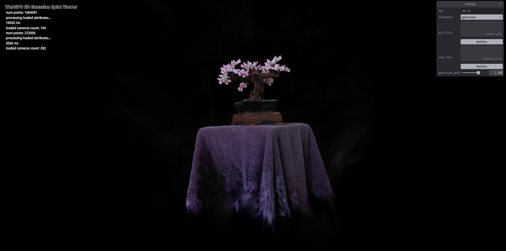

# Project5-WebGPU-Gaussian-Splat-Viewer

**University of Pennsylvania, CIS 565: GPU Programming and Architecture, Project 5**

* Andrea Gonzalez Varela
* Tested on: **Google Chrome for Testing v157.0.8102.0** on
  Linux, 13th Gen Intel(R) Core(TM) i9-13980HX @ 5.6GHz 128GB, RTX 2000 Ada Generation 8GB (Personal)

### Live Demo

[andrgv.gitub.io/Project5-WebGPU-Gaussian-Splat-Viewer](https://andrgv.github.io/Project5-WebGPU-Gaussian-Splat-Viewer/)

### Demo Video/GIF

### Project description

This is an implementation of Gaussian splat rendering and point-cloud view of scenes in WebGPU. This Gaussian renderer projects and culls, splat, sorts visible splats by depth and draws them with view-dependent color and alpha blending. The viewer allows visualization of custom PLY scenes, camera presets and control of the size of the Gaussian splats.

### Performance Analysis

#### Compare your results from point-cloud and gaussian renderer, what are the differences?

The cleaned bicycle renders at 41.50 fps, while the gaussian renderer hovers around 40 fps, indicating that the additionaly computation to create the gaussian splats has  negative effect on the performance

#### For gaussian renderer, how does changing the workgroup-size affect performance? Why do you think this is?

I tested workgroup sizes from 32 to 256 and they all ran at around 40 fps. The constant performance indicates that workgroup size was not the bottleneck of my implementation, in this test on my hardware. I chose 32-256 because smaller sizes exceeded WebGPU's dispatch limit and larger sizes exceeded my device's configured workgroup limit.

#### Does view-frustum culling give performance improvement? Why do you think this is?

Both versions (cleaned bicycle with and without view-frustum culling) ran at approximately 40 FPS. View-frustum culling did not appear to improve performance in this view. This might be because most gaussian splats were visible or other work was the bottleneck.

#### Does number of gaussians affect performance?  Why do you think this is?

I ran the bonsai with around 300,000 points and the cleaned bike with 30,000 points and they both ran at 40 fps. The not-cleaned version of the bicycle took too long to load on my laptop, so Iwas not able to benchmark it. While more gaussians generally increase preprocessing and sorting work, this did not seem to have a measurable impact on the performance of my test, which indicates that the bottleneck in performance is elsewhere.

### Credits

* [repo-sam.inria.fr/fungraph/3d-gaussian-splatting](https://repo-sam.inria.fr/fungraph/3d-gaussian-splatting/)

- [Vite](https://vitejs.dev/)
- [tweakpane](https://tweakpane.github.io/docs//v3/monitor-bindings/)
- [stats.js](https://github.com/mrdoob/stats.js)
- [wgpu-matrix](https://github.com/greggman/wgpu-matrix)
- Special Thanks to: Shrek Shao (Google WebGPU team) & [Differential Guassian Renderer](https://github.com/graphdeco-inria/diff-gaussian-rasterization)
